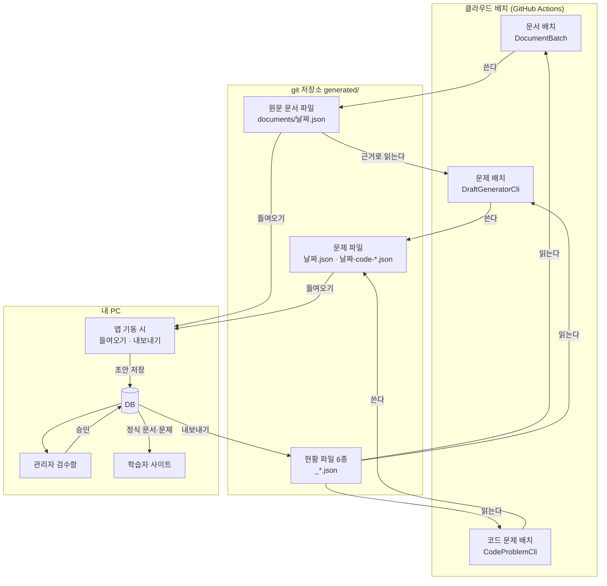
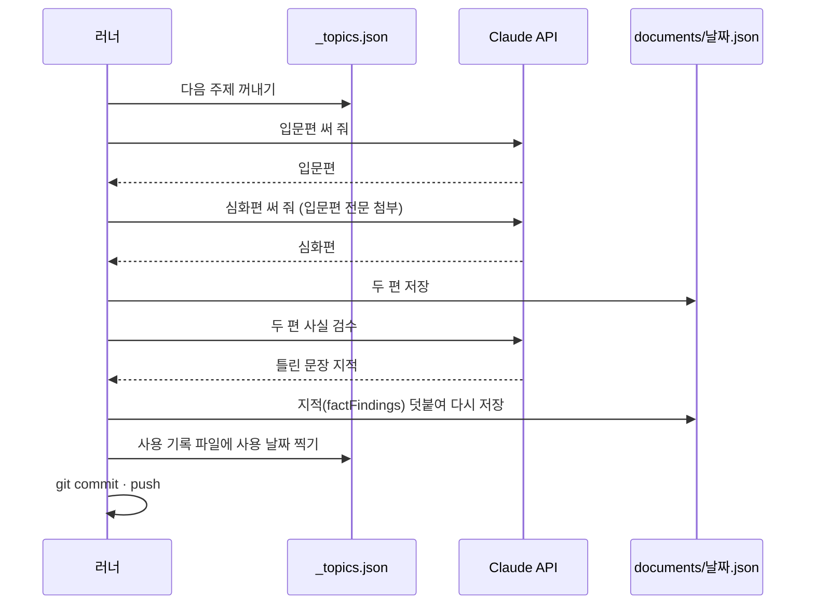
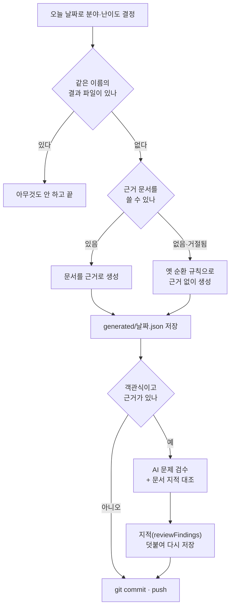
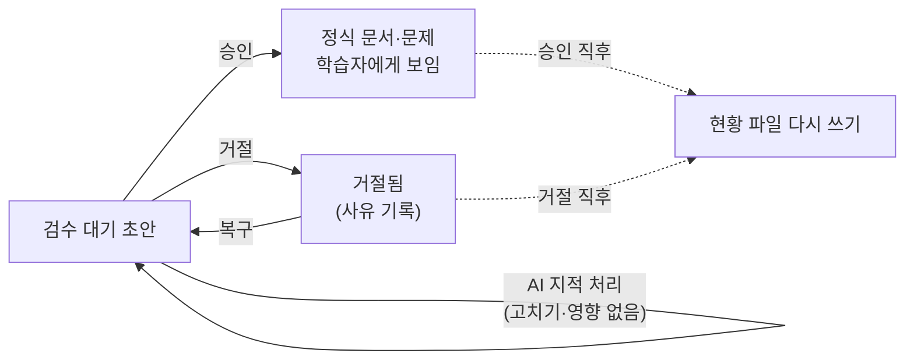

# 28. 콘텐츠 흐름도 (인수인계용)

이 사이트의 문서와 문제가 어디서 만들어져, 어떤 길을 거쳐 학습자에게 닿는지 그림으로 정리했다.
처음 맡은 사람이 이 문서 하나로 전체 길을 따라갈 수 있게 쓰는 것이 목표다.

이 문서는 **지금 코드가 하는 일만** 적는다. 잘됐는지 못됐는지는 판단하지 않는다.
설계 이유는 각 절 끝의 링크 문서에 있다. 2026-11-01 코드 기준이다.

---

## 1. 먼저 알아 둘 것

### 등장인물

| 이름 | 무엇인가 | 어디에 있나 |
|---|---|---|
| 클라우드 배치 | Claude API를 불러 문서·문제 초안을 만드는 프로그램 | GitHub Actions 러너. 돌고 나면 사라지는 임시 컴퓨터다 |
| `generated/` 폴더 | 배치가 만든 결과와 앱이 내보낸 목록이 오가는 곳 | git 저장소 안 |
| 앱 | Spring Boot 서버. 학습자 사이트와 관리 콘솔을 함께 띄운다 | 내 PC (포트 8080) |
| DB | MySQL. 정식 문서·문제와 초안을 담는다 | 내 PC |
| 관리자 | 검수함에서 초안을 읽고 승인·거절한다 | 관리 콘솔 화면 |
| 학습자 | 승인된 문서를 읽고 문제를 푼다 | 사이트 화면 |

### 가장 중요한 제약 하나

**클라우드 배치는 DB를 볼 수 없다.** 러너는 내 PC의 MySQL에 접속하지 못한다.
그래서 배치와 앱은 오직 **git 저장소의 파일**로만 이야기한다.
택배함이 하나 있고 양쪽이 번갈아 물건을 넣고 꺼내는 구조다.

### 이 문서에서 쓰는 말

| 말 | 뜻 |
|---|---|
| 초안 | AI가 만들었지만 아직 승인 전이라 학습자에게 안 보이는 문서·문제 |
| 들여오기 | `generated/`의 파일을 DB 초안으로 옮겨 담는 일 |
| 현황 파일 | 앱이 DB 상태를 적어 배치에 넘기는 파일 (`generated/_*.json`) |
| 원문 문서 | 문제를 뽑는 바탕이 되는 개념 문서 (`generated/documents/*.json`) |
| 입문편·심화편 | 한 주제로 같이 만드는 문서 두 편. 입문편은 초급, 심화편은 중·고급 문제의 근거다 |

---

## 2. 한 장으로 보는 전체 흐름

한 바퀴를 말로 따라가면 이렇다.

1. 새벽에 클라우드 배치가 돌아 문서나 문제 초안을 `generated/`에 쓰고 git에 push한다.
2. 내 PC에서 git pull 뒤 앱을 띄우면, 앱이 새 파일을 DB 초안으로 들여온다.
3. 관리자가 검수함에서 초안을 승인하면 정식 문서·문제가 되어 학습자에게 보인다.
4. 앱은 DB 상태(기존 문제 목록, 거절 사례 등)를 현황 파일로 내보낸다.
5. 관리자가 배치 현황 화면의 "배치로 보내기"를 누르면 앱이 현황 파일을 커밋·push한다. 다음 날 배치가 그 파일을 읽고 중복을 피한다.

---

## 3. 언제 무엇이 만들어지나

### 개념 문서·문제: 매일 01:17 (한국 시간)

워크플로는 `.github/workflows/llm-daily.yml`이다. 날짜만으로 오늘 할 일을 정한다.

| 주기 날짜 | 만드는 것 | 근거 |
|---|---|---|
| 0일차 | 개념 문서 1주제 (입문편 + 심화편) | 주제 대기열 `_topics.json` |
| 1일차 | 초급 문제 | 0일차 입문편 |
| 2일차 | 중급 문제 | 0일차 심화편 |
| 3일차 | 고급 문제 | 0일차 심화편 |

- 4일이 지나면 다음 분야로 넘어간다. 기준일은 `application.yml`의 `llm.generation.cycle-anchor`다.
- 끄는 스위치는 `llm.generation.batch-enabled`다.
- Batch API로 부른다. 요금이 반값인 대신 답이 늦게 온다.

### 자바 코드 문제: 매주 일요일 02:47 (한국 시간)

워크플로는 `.github/workflows/llm-code-problems.yml`이다. 주제는 `_code-topics.json`에서 꺼낸다.
모델이 쓴 코드를 실제로 돌려 정답을 확인하는 단계가 따로 있다. 그 단계에는 API 키를 주지 않는다.

자세한 규칙: [16 운영 매뉴얼](16-llm-pipeline-operations.md) · [24 코드 문제](24-java-code-problems.md)

---

## 4. 흐름 A: 개념 문서 만들기 (클라우드)

1. `_topics.json`(주제 대기열)과 `_topic-usage.json`(사용 기록)을 합쳐 차례가 된 주제를 꺼낸다. 비었으면 모델이 주제를 고른다.
2. `_existing-documents.json`을 읽어 이미 있는 제목을 피하게 한다.
3. 입문편을 만들고 그 전문을 넘겨 심화편을 만든다. 심화편이 실패해도 입문편은 저장한다.
4. 두 편을 `generated/documents/<날짜>.json`에 쓴다.
5. AI가 두 편을 사실 검수한다. 지적은 같은 파일의 `factFindings`에 덧붙인다.
6. 주제 대기열에 "이 날짜에 썼음"을 찍는다. 대기열 파일도 함께 커밋된다.

코드 위치: `llm/cli/DocumentBatch.java`

---

## 5. 흐름 B: 문제 만들기 (클라우드)

1. 날짜로 분야·난이도·근거 문서 날짜를 계산한다.
2. 같은 이름의 결과 파일이 이미 있으면 멈춘다. 같은 날 두 번 돌려도 요금이 한 번만 나간다.
3. 근거 문서 파일을 연다. 없거나 `_existing-documents.json`의 거절 목록에 있으면 근거 없이 만든다.
4. `_existing-questions.json`(기존 문제)과 `_rejection-notes.json`(거절 사례)을 프롬프트에 싣는다.
5. 문제를 받아 빈 껍데기를 걷어 내고 `generated/<날짜>.json`에 쓴다.
6. 객관식이고 근거가 있으면 AI가 문제를 검수한다. 근거 문단을 문서 사실 검수가 지적했다면 "문서 지적"을 덧붙인다.

코드 위치: `llm/cli/DraftGeneratorCli.java`, `llm/cli/SourceDocumentFinder.java`

---

## 6. 흐름 C: 앱이 뜰 때 (내 PC)

앱은 기동할 때 정해진 순서로 열 가지 일을 한다. 숫자는 코드의 `@Order` 값이다.

| 순서 | 클래스 | 방향 | 하는 일 |
|---|---|---|---|
| 4 | `DomainSettingSyncRunner` | — | 분야 표가 비었으면 기본 분야 11개로 채운다 |
| 5 | `TopicQueueSyncRunner` | 파일 → DB | 주제 대기열 파일에서 손으로 적은 새 주제를, 사용 기록 파일에서 배치가 찍은 사용 날짜를 DB로 가져온다 |
| 10 | `DraftImportRunner` | 파일 → DB | 새 문제·문서 파일을 초안으로 들여온다. 이미 들여온 파일은 건너뛴다 |
| 15 | `ApprovedDocumentFileSync` | DB → 파일 | 정식 문서와 다른 원문 문서 파일의 제목·slug·본문을 정식 문서에 맞춘다 |
| 20 | `RejectionNotesExporter` | DB → 파일 | `_rejection-notes.json` |
| 30 | `ExistingDocumentsExporter` | DB → 파일 | `_existing-documents.json` |
| 40 | `ExistingQuestionsExporter` | DB → 파일 | `_existing-questions.json` |
| 50 | `TopicQueueExporter` | DB → 파일 | `_topics.json` |
| 51 | `CodeTopicQueueExporter` | DB → 파일 | `_code-topics.json` |
| 60 | `DomainSettingExporter` | DB → 파일 | `_domain-settings.json` |

- "파일 → DB"가 앞, "DB → 파일"이 뒤다. 순서가 뒤집히면 파일의 사용 날짜를 읽기 전에 덮어쓴다.
- 들여온 파일은 `imported_draft_file` 표에 이름을 적어 두어 두 번 들여오지 않는다.
- 들여올 때 규칙에 어긋난 문제(예: 객관식인데 정답이 둘)는 저장하지 않는다.
- 문서 파일의 사실 지적은 들여올 때 편마다 나눠 초안에 담는다.
- `llm.import.enabled=false`로 띄우면 위 일 중 4번을 뺀 전부를 건너뛴다.

코드 위치: `llm/service/` 아래 각 클래스

---

## 7. 흐름 D: 검수에서 공개까지 (관리 콘솔)

검수함은 `admin/llm.html` 한 화면에 문제 · 코드 문제 · 문서 세 탭으로 있다.

| 할 일 | 문제 초안 | 문서 초안 |
|---|---|---|
| 승인 | `problem` 표에 정식 문제를 만든다. 한 번에 여러 건도 된다 | `document` 표에 정식 문서를 만든다. 한 번에 여러 건도 된다 |
| 거절 | 사유를 남긴다. 다음 배치의 거절 사례로 쓰인다 | 사유를 남긴다. 그 문서는 다음 배치의 근거에서 빠진다 |
| 복구 | 거절한 것만 대기로 되돌린다 | 같다 |
| AI 지적 보기 | AI 문제 검수 지적과 문서 지적 | AI 사실 검수 지적 |
| AI 지적 처리 | 제안 적용 · 칸 골라 직접 고치기 · 영향 없음 | 문단 고치기 · 고치지 않음 |

- 승인·거절·복구가 커밋되면 앱이 `ReviewCompleted` 사건을 내고 현황 파일 세 개를 바로 다시 쓴다.
- 처리한 AI 지적은 지우지 않고 처리 기록과 함께 접힌 칸으로 옮긴다.
- 문서 초안의 문단을 고치면 앱이 원문 문서 파일(`documents/<날짜>.json`)의 같은 본문도 고친다.
- 승인된 뒤에는 검수함에서 고칠 수 없다. 문제 관리·문서 관리 화면에서 고친다.
- 문서 관리에서 정식 문서를 고치거나 옛 판으로 되돌리면 `DocumentContentChanged` 사건이 나가고, 앱이 원문 문서 파일도 맞춘다.

코드 위치: `llm/service/LlmProblemService.java`, `llm/service/LlmDocumentService.java`

---

## 8. 흐름 E: 앱이 배치에 넘기는 현황 파일

배치가 DB를 못 보는 대신 읽는 파일들이다. 앱이 쓰고, **커밋·push해야** 배치에 닿는다.
관리 콘솔의 "배치로 보내기"가 이 파일들과 원문 문서 파일(`documents/*.json`)만 골라 커밋·push한다([29](29-generated-publish.md)).

| 파일 | 담는 것 | 언제 다시 쓰나 | 누가 읽나 |
|---|---|---|---|
| `_existing-questions.json` | 이미 있는 문제의 질문 | 기동 · 검수 직후 | 문제 배치 (중복 회피) |
| `_rejection-notes.json` | 최근 거절 사례와 사유 | 기동 · 검수 직후 | 문제 배치 (같은 실수 피하기) |
| `_existing-documents.json` | 문서 제목·태그, 거절된 문서 slug | 기동 · 검수 직후 | 문서 배치 (중복 회피), 문제 배치 (거절 문서 건너뛰기) |
| `_topics.json` | 문서 주제 대기열, 사용 기록을 초기화한 날(`usageResetAt`) | 기동 · 대기열을 고친 직후 | 문서 배치. 앱만 쓴다 |
| `_code-topics.json` | 코드 문제 주제 대기열 | 기동 · 대기열을 고친 직후 | 코드 문제 배치. 앱만 쓴다 |
| `_topic-usage.json`·`_code-topic-usage.json` | 주제마다 마지막 사용일·횟수 | 배치가 주제를 쓸 때 | **배치만 쓴다.** 앱은 기동할 때 읽어 DB에 반영한다 |
| `_domain-settings.json` | 켜 둔 분야와 순서·이름·힌트 | 기동 · 분야 설정을 고친 직후 | 세 배치 모두 |

- 내용이 바뀔 때만 파일을 쓴다. 그대로면 git에 변경이 안 생긴다.
- 보낼 변경이 있으면 관리 콘솔 상단 띠에 "보낼 변경 N" 칩이 뜬다. 칩을 누르면 배치 현황 화면의 보내기 칸으로 간다.
- 보내기는 main 브랜치에서만 한다. git 작업이 진행 중이거나, 사람이 올리지 않은 커밋이 있거나, 원격이 바꾼 파일을 사람도 고치고 있으면 멈추고 이유를 보여 준다.
- 운영 컨테이너처럼 저장소가 없는 곳에서는 칩이 숨고 보내기를 쓸 수 없다.
- 현황 파일이 14일 넘게 안 바뀌면 문제 배치가 요약에 경고를 남긴다. 보내기를 잊었을 수 있다는 신호다.

코드 위치: `llm/service/GeneratedPublisher.java`, `admin/controller/AdminGeneratedController.java`

---

## 9. 배치 말고 초안이 들어오는 길

| 입구 | 누가 | 지나는 길 | AI 검수 |
|---|---|---|---|
| 새벽 배치 | GitHub Actions | 파일 → 들여오기 → 초안 | 있음 |
| 관리 화면 "문제 생성" | 관리자 | 앱이 Claude를 바로 불러 DB 초안으로 저장. 파일 없음 | 없음. 근거 문서가 없어 검수기가 대조할 것이 없다 |
| 관리 화면 "문서로 문제 생성" | 관리자 | 등록 문서·업로드 파일·붙여넣기로 Claude를 바로 불러 DB 초안으로 저장. 파일 없음 | 있음. 객관식이고 "AI 검수도 돌리기"를 켰을 때(기본 켬) 생성 직후 같은 요청에서 배치와 같은 검수기로 본다 |
| 파일을 손으로 쓰기 | 사람 또는 Claude Code | `generated/`에 배치와 같은 모양으로 파일을 쓰고 커밋 → 들여오기 | 서브에이전트로 따로 돌린 기록이 있다 |
| 수동 배치 실행 | 사람 | GitHub의 workflow_dispatch로 날짜·분야·주제를 골라 실행. 이후는 새벽 배치와 같다 | 있음 |

- 관리 화면 두 경로는 로컬 API 키(`<GRADLE_USER_HOME>\gradle.properties`)를 쓴다.
- 손으로 채울 때는 결과 파일 이름에 `--suffix`를 붙인다. 날짜 이름을 쓰면 그날 예약 실행이 "이미 있음"으로 멈춘다.

---

## 10. 같은 내용이 여러 곳에 있는 자리

판단 없이 사실만 적는다. 고칠 때 함께 맞춰야 하는 곳이다.

| 내용 | 있는 곳 | 지금 맞추는 방법 |
|---|---|---|
| 개념 문서 본문 | ① `document` 표 (학습자가 읽음) ② `generated_document_draft` 표 ③ `generated/documents/<날짜>.json` (문제 배치가 읽음) | ③은 늘 최신본을 따른다. 승인 전: 검수함 문단 고치기가 ②③을 함께 고친다. 승인 후: 문서 관리가 ①을 고치면 ③도 맞춘다. 앱이 뜰 때도 ①에 맞춰 ③을 고친다. ②는 승인 뒤 그대로 남는다 |
| 문제 본문 | ① `problem` 표 ② `generated_problem_draft` 표 ③ `generated/<날짜>.json` | 승인 전: 검수함 지적 처리가 ②만 고친다. 승인 후: 문제 관리가 ①만 고친다 |
| 주제 대기열 | ① DB `topic_queue` 표 ② `_topics.json`·`_code-topics.json` ③ `_topic-usage.json`·`_code-topic-usage.json` | ②는 앱만, ③은 배치만 쓴다. 앱은 기동 때 ②의 손으로 적은 줄과 ③의 사용일을 DB로 읽고, 그다음 DB → ②로 쓴다. 관리 화면에서 사용 기록을 초기화하면 ②에 초기화한 날이 실리고, 앱과 배치가 그날까지의 ③ 기록을 무시한다 |
| 분야 목록 | ① DB `domain_setting` ② `_domain-settings.json` | 앱이 DB → 파일로만 쓴다 |
| 문서 조회 결과 | ① `document` 표 ② Redis 캐시 (10분) | 관리 API로 고치면 캐시를 지운다. SQL로 바로 고치면 10분간 옛 본문이 나간다 |
| 거절 사례 | 앱은 DB에서 바로 읽고, 배치는 `_rejection-notes.json`을 읽는다 | 앱이 검수 직후 파일을 다시 쓴다 |

---

## 11. 문제가 생기면 어디부터 보나

| 증상 | 먼저 볼 곳 |
|---|---|
| 아침에 검수함이 비었다 | GitHub Actions 실행 요약 → `generated/`에 새 파일이 있는지 → 앱을 pull 뒤 다시 띄웠는지 |
| 같은 주제 문서가 또 나왔다 | `_topic-usage.json`에 사용 날짜가 찍혔는지, 상단 띠에 "보낼 변경" 칩이 남아 있는지 |
| 문제가 근거 없이 나왔다 | 그 주기의 원문 문서 파일이 있는지, 거절된 문서인지 |
| 거절한 실수가 되풀이된다 | 상단 띠에 "보낼 변경" 칩이 남아 있는지(`_rejection-notes.json`을 보냈는지) |
| "배치로 보내기"가 충돌로 멈췄다 | 배치가 같은 파일을 바꿨다. pull한 뒤 충돌을 풀고 다시 누른다. 주제 대기열은 2026-11-02부터 앱과 배치가 다른 파일을 써서 여기서 충돌하지 않는다 |
| 고친 문서가 사이트에 안 보인다 | Redis 캐시 (`document::<slug>`) |

더 자세한 운영 방법: [16 운영 매뉴얼](16-llm-pipeline-operations.md)
