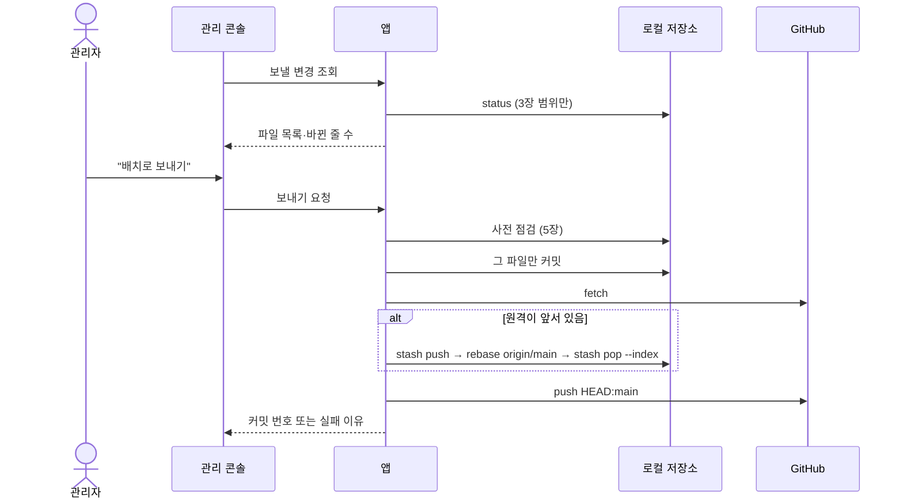

# 29. 앱이 고친 파일을 배치로 보내기 (설계)

관리 콘솔에서 바뀐 현황 파일과 원문 문서 파일을 버튼 하나로 커밋·push한다.
`REVIEW_2026-11-01-flow.md` 순위 3을 고치는 설계다. 2026-11-02에 C안으로 정했고, 같은 날 10장의 모듈 1~4를 구현했다.

---

## 1. 왜 하나

앱은 `generated/` 아래 파일을 고치기만 하고 커밋하지 않는다. 클라우드 배치는 원격 저장소의 파일만 읽는다.
그래서 사람이 커밋·push하기 전까지 관리 콘솔에서 한 일이 배치에 닿지 않는다.

| 앱이 쓰는 파일 | 쓰는 코드 | push를 잊으면 배치가 하는 일 |
|---|---|---|
| `_existing-documents.json` | `ExistingDocumentsExporter` | 이미 있는 주제나 거절된 slug로 문서를 또 쓴다 |
| `_existing-questions.json` | `ExistingQuestionsExporter` | 이미 있는 문제와 비슷한 문제를 낸다 |
| `_rejection-notes.json` | `RejectionNotesExporter` | 거절 사례를 모른 채 같은 실수를 한다 |
| `_topics.json` | `TopicQueueExporter` | 화면에서 바꾼 주제 순서를 모른다 |
| `_code-topics.json` | `CodeTopicQueueExporter` | 화면에서 바꾼 코드 주제를 모른다 |
| `_domain-settings.json` | `DomainSettingExporter` | 화면에서 바꾼 분야 설정을 모른다 |
| `documents/*.json` | `DocumentFileSync` | 고치기 전 본문을 근거로 문제를 낸다 |

지금 있는 안전장치는 하나다. 배치가 14일 넘게 안 바뀐 현황 파일을 요약에 경고로 적는다(`BatchHistory.SNAPSHOT_STALE_DAYS`).
14일 안에 잊은 것은 아무도 모른다. 2026-11-02에도 `_existing-*.json` 두 개가 커밋되지 않은 채 있었다.

## 2. 정한 것과 고르지 않은 안

| 안 | 방식 | 고르지 않은 이유 |
|---|---|---|
| **C. 버튼으로 보내기 (정함)** | 관리 콘솔이 보낼 변경 수를 띄우고 누르면 그 파일만 커밋·push | — |
| A. 파일을 쓸 때마다 자동 push | 내보내기 직후 앱이 git을 실행 | 사람이 모르는 사이에 앱이 작업 폴더를 rebase한다. 하루에 커밋이 수십 개 생긴다 |
| B. GitHub API로 파일만 올림 | 작업 폴더는 두고 원격에 직접 쓴다 | 토큰을 새로 받아 두어야 한다. 로컬 저장소가 pull 전까지 원격과 어긋난다 |

C안은 잊을 수 있다는 약점이 있다. 그래서 상단 띠에 보낼 변경 수를 늘 띄운다(6장).

git은 앱이 `git` 명령을 직접 실행해서 쓴다. JGit 라이브러리는 쓰지 않는다.
JGit을 쓰면 의존성이 늘고 사용자 PC의 Git Credential Manager 인증을 따로 맞춰야 한다.

## 3. 보내는 파일의 범위

아래 두 경로에 맞는 파일만 보낸다. 새 파일(추적 안 됨)도 넣는다.

```
generated/_*.json
generated/documents/*.json
```

배치 결과 파일(`generated/2026-11-02.json` 같은 것)은 넣지 않는다. 앱은 그 파일을 쓰지 않는다.
사람이 손으로 채운 파일이 섞이지 않게 범위를 앱이 쓰는 곳으로 좁혔다.

## 4. 흐름



커밋 메시지는 이렇게 쓴다. 작성자는 사용자 PC의 git 설정을 그대로 쓴다.

```
chore(generated): 관리 콘솔에서 바뀐 파일 3개를 배치로 보낸다

- generated/_existing-documents.json
- generated/_existing-questions.json
- generated/documents/2026-10-29.json
```

## 5. 사용자 작업을 건드리지 않는 규칙

앱은 사용자가 작업 중인 저장소에서 git을 실행한다. 아래 규칙을 어기면 보내지 않고 이유를 돌려준다.

| 점검 | 막는 일 | 걸리면 |
|---|---|---|
| 현재 브랜치가 `main`이다 | 작업 브랜치에 현황 파일 커밋이 섞인다 | 멈춤. "main에서 보내세요" |
| rebase·merge가 진행 중이 아니다 | 사람이 풀던 충돌을 앱이 망친다 | 멈춤 |
| 안 올린 커밋(`origin/main..HEAD`)이 없다 | 사람이 아직 올리지 않은 커밋이 함께 나간다 | 멈춤. 그 커밋 목록을 보여 준다 |
| 원격의 새 커밋이 바꾼 파일을 사람도 고치고 있지 않다 | rebase 뒤 사람의 변경을 되돌릴 때 충돌한다 | 멈춤. "먼저 pull하세요"와 겹친 파일 |

커밋할 때는 파일을 지정한다(`git commit --only -- <파일>`). 사람이 미리 스테이지해 둔 다른 파일은 커밋에 들어가지 않는다.
사람이 고치던 다른 파일은 앱이 `git stash push`로 잠시 치웠다가 rebase 뒤 `git stash pop --index`로 되돌린다.
`rebase --autostash`는 쓰지 않는다. 되돌릴 때 스테이지 상태를 살리지 않아, 사람이 `git add`해 둔 파일이 풀린다(모듈 1 테스트에서 확인).
겹친 파일은 위 넷째 점검이 미리 막는다. 그래서 되돌릴 때 충돌하지 않는다.

### 실패하면

| 실패 | 앱이 하는 일 | 그 뒤 상태 |
|---|---|---|
| rebase 충돌 (배치가 같은 파일을 바꿈) | `rebase --abort`, `stash pop --index` 뒤 `reset --soft HEAD~1`로 커밋을 풀고 보낸 파일만 스테이지에서 내린다. `--mixed`로 풀면 사람이 스테이지한 파일까지 풀린다 | 누르기 전과 같다. 파일은 고친 채 커밋 전 |
| push 거부 (그 사이 배치가 push함) | fetch·rebase·push를 한 번 더 한다 | 두 번째도 거부되면 커밋은 남기고 "다시 누르세요" |
| 처음 fetch가 안 됨(인증 실패·네트워크 끊김) | 아무것도 커밋하지 않고 "실패"로 알린다 | 누르기 전과 같다 |
| push가 안 됨(인증 실패·네트워크 끊김) | 커밋은 남긴다 | 다음에 누르면 push만 다시 한다 |
| 명령이 60초를 넘김 | 프로세스를 끝낸다. rebase 도중이면 `rebase --abort`로 되돌리고 치워 둔 작업을 `stash pop --index`로 꺼낸다 | 이번 커밋은 남긴다. 다음에 누르면 push만 다시 한다 |

rebase 충돌은 거의 `_topics.json`에서 난다. 배치가 사용 기록을 그 파일에 쓰기 때문이다.
앱과 배치가 같은 파일을 쓰는 문제는 REVIEW 순위 5에서 따로 고친다.

인증 창이 뜨면 앱이 멈춘다. 그래서 `GIT_TERMINAL_PROMPT=0`을 주고 실행한다.
한글 경로가 깨지지 않게 `-c core.quotepath=false`와 `status -z`를 쓴다.
보내기는 한 번에 하나만 돈다. 두 번째 요청은 "보내는 중"을 돌려준다.

## 6. 화면

| 자리 | 보이는 것 |
|---|---|
| 상단 띠 | 보낼 변경이 있으면 주황 칩 "보낼 변경 3". 마우스를 올리면 가장 오래된 변경 시각과 다음 배치 시각(한국 01:17) |
| 배치 현황 화면 (`batch.html`) | "배치로 보낼 변경" 칸. 파일마다 종류(현황 파일·원문 문서)·바뀐 시각·바뀐 줄 수, 그리고 "배치로 보내기" 버튼 |
| 내용 보기 | 파일 줄의 "내용 보기"를 누르면 그 아래에 바뀐 줄을 펼친다. 더한 줄은 초록, 뺀 줄은 빨강이다. 뺀 줄과 더한 줄을 짝지어 실제로 달라진 글자에 테두리를 친다. 현황 파일은 제목 목록이 한 줄이라 줄만 칠하면 무엇이 바뀌었는지 못 찾는다. 400줄이 넘으면 앞부분만 싣는다 |
| 보낸 뒤 | 커밋 번호와 GitHub 커밋 링크. 실패하면 5장 표의 이유와 할 일 |

칩 숫자는 배지 요청(`/api/admin/badge-counts`)에 한 칸 더해 받는다. 화면을 옮길 때마다 `git status`가 돌지 않게 15초 동안 결과를 재사용한다.

## 7. API

| 메서드 | 경로 | 하는 일 |
|---|---|---|
| GET | `/api/admin/generated/pending` | 보낼 파일 목록, 바뀐 줄 수, 바뀐 시각, 보내기 가능 여부와 막힌 이유 |
| GET | `/api/admin/generated/diff?path=` | 보낼 파일 하나의 바뀐 줄. 보낼 파일 목록에 없는 경로는 읽지 않고 이유만 돌려준다 |
| POST | `/api/admin/generated/publish` | 4장 흐름을 실행하고 커밋 번호 또는 실패 이유를 돌려준다 |

두 API는 막힘·충돌·push 실패도 200으로 돌려준다. 결과 종류는 본문의 `status`에 담는다. 실패 응답으로 내리면 화면이 이유와 겹친 파일 목록을 받지 못한다.
보내기 기능을 끄면(`llm.publish.enabled=false`) 둘 다 "쓸 수 없음"을 돌려준다.

보내기를 누를 때마다 감사 기록에 남긴다. 이름표는 `AdminActionLabels`에 "배치로 보내기"로 더했다.
감사 기록 표에는 상세 칸이 없어 누가 언제 눌렀는지만 남는다. 무엇을 보냈는지는 git 커밋에 남고, 실패 이유는 앱 로그에 남는다.

## 8. 켜고 끄기

| 환경 | 동작 |
|---|---|
| 내 PC (`bootRun`, IntelliJ) | 켜짐. `llm.import.dir`에서 `git rev-parse --show-toplevel`이 되고 `origin`이 있을 때만 |
| 운영 컨테이너 (GHCR 이미지) | 꺼짐. 이미지 안에 `.git`이 없다. 칩을 숨기고 API는 "쓸 수 없음"을 돌려준다 |
| 테스트 | 꺼짐(`llm.publish.enabled=false`). 보내기 테스트만 임시 저장소로 켠다 |

## 9. 테스트

테스트마다 임시 폴더에 원격 역할의 빈 저장소(`git init --bare`)와 그 복제본을 만든다. 실제 저장소는 건드리지 않는다.

| 확인할 것 | 방법 |
|---|---|
| 범위 밖 파일은 안 나간다 | 배치 결과 파일과 `src/` 파일을 함께 고친 뒤 보내고 커밋에 두 경로만 들었는지 본다 |
| 스테이지해 둔 다른 파일이 안 섞인다 | 다른 파일을 `git add`한 채 보낸다 |
| 원격이 앞서 있으면 rebase 뒤 push | 두 번째 복제본에서 먼저 push해 둔다 |
| rebase 충돌이면 누르기 전으로 돌아온다 | 두 복제본에서 `_topics.json`을 다르게 고친다 |
| 5장 점검 넷 | 각 상황을 만들어 멈추는지 본다 |
| 사람이 고치던 파일이 그대로다 | 범위 밖 파일을 고친 채 rebase가 일어나게 하고 내용을 비교한다 |

## 10. 구현 순서

| 모듈 | 내용 |
|---|---|
| 1 | `GitWorkspace`(명령 실행·시간 제한·출력 읽기)와 `GeneratedPublisher`(보낼 변경 조회·점검·보내기), 9장 테스트 |
| 2 | API 두 개, 배지 칸, 감사 이름표 |
| 3 | 상단 띠 칩과 `batch.html` 칸, 8081에서 확인 |
| 4 | `28-content-flow.md`·REVIEW 5장 갱신. `SnapshotExporter`의 "앱이 직접 push하지 않는다" 주석 고치기 |

## 11. 하지 않는 것

- 정해진 시각 자동 보내기. 필요해지면 칩이 띄운 시각을 보고 다시 정한다.
- 배치 결과 파일과 그 밖의 파일 보내기.
- `_topics.json`을 앱과 배치가 함께 쓰는 문제 (REVIEW 순위 5).
