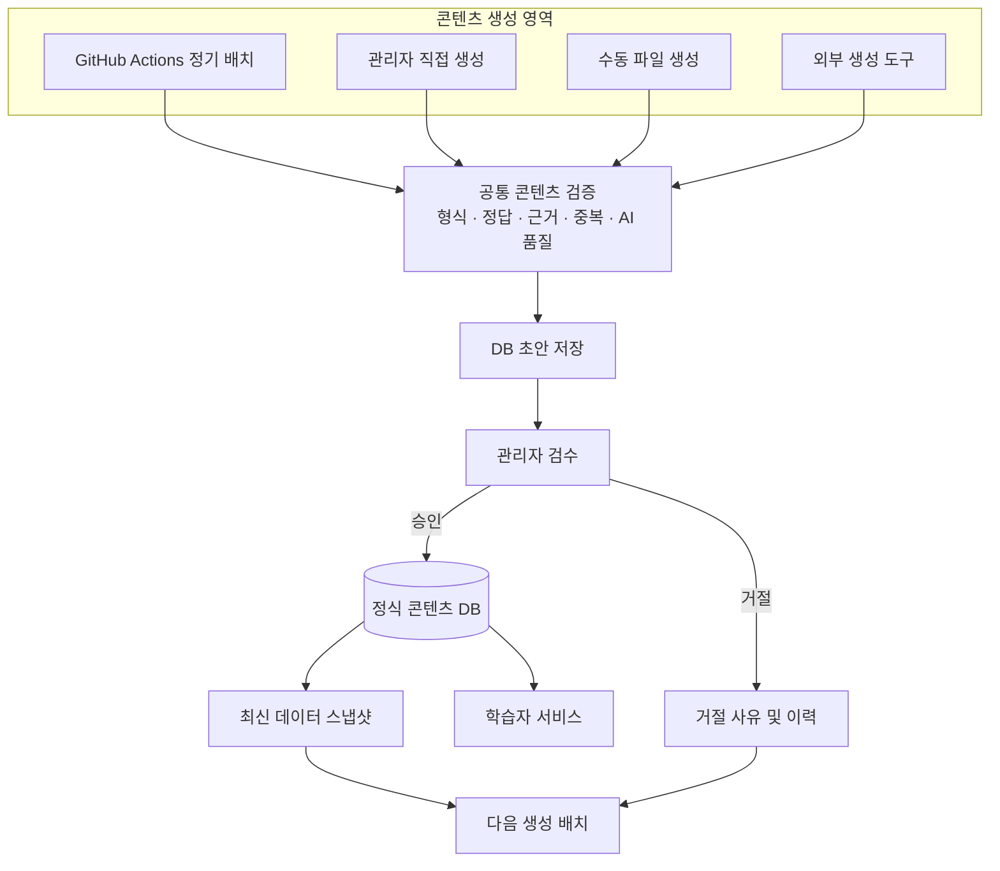

# 프로젝트 콘텐츠 흐름도 객관적 분석

## 1. 종합 의견

이 프로젝트는 단순히 AI로 문서와 문제를 생성하는 구조가 아니라 **AI 콘텐츠 생성 → 파일 기반 전달 → DB 적재 → 관리자 검수 → 학습자 공개 → 운영 데이터 피드백**으로 이어지는 콘텐츠 생산 파이프라인이다.

전체적인 설계 방향은 합리적이다. 특히 클라우드 배치와 로컬 DB를 분리하고, 파일을 중간 매개체로 사용하며, 관리자 승인 후에만 콘텐츠를 공개하는 구조는 분명한 장점이 있다.

다만 운영 규모가 커질수록 문제가 될 수 있는 부분도 있다. 가장 중요한 위험은 다음 세 가지다.

1. **데이터 동기화:** DB와 Git 파일에 같은 콘텐츠가 중복 저장되어 데이터 불일치가 발생할 수 있다.
2. **품질 관리:** 콘텐츠 생성 경로마다 AI 검수 여부가 달라 품질 관리 수준이 일관되지 않다.
3. **운영 안정성:** Git 커밋·푸시와 앱 재기동에 사람이 개입해야 하므로 운영 자동화가 완결되어 있지 않다.

이 문서는 제공된 `28. 콘텐츠 흐름도 (인수인계용)`의 현재 동작을 기준으로 분석한다. 실제 코드를 직접 검토하거나 운영 로그·장애 통계를 확인한 것은 아니므로, 문서에 명시된 사실과 그 사실로부터 도출한 잠재적 위험을 구분한다.

---

## 2. 장점 분석

### 2.1. 클라우드 배치와 애플리케이션의 역할 분리

현재 구조에서는 GitHub Actions가 Claude API를 이용해 콘텐츠를 생성하고, Spring Boot 애플리케이션은 생성된 파일을 DB에 적재하고 관리한다. 클라우드 배치는 로컬 DB에 직접 접근하지 않고 Git 저장소의 파일을 통해 데이터를 주고받는다.

**장점인 이유**

- 시스템 간 결합도가 낮다. 배치는 Spring Boot 애플리케이션의 내부 구현을 알 필요 없이 약속된 JSON 형식으로 결과를 저장하면 된다.
- 데이터베이스 접근 권한을 클라우드 배치에 직접 제공하지 않아도 된다.
- 생성 시스템과 서비스 시스템을 독립적으로 변경할 수 있다.
- Claude API를 다른 LLM API로 변경하더라도 파일 형식과 인터페이스를 유지하면 애플리케이션 측 변경을 최소화할 수 있다.

**개선 방향**

현재 역할 분리는 유지하는 것을 권장한다. 생성 시스템과 서비스 시스템을 무리하게 하나로 합칠 필요는 없다. 다만 파일을 통한 통신 규약을 명확하게 정의하고 버전 관리해야 한다.

### 2.2. 콘텐츠 공개 전 관리자 검수

AI가 생성한 콘텐츠는 초안으로 DB에 저장되고 관리자가 승인해야 정식 콘텐츠가 되어 학습자에게 공개된다.

**장점인 이유**

AI가 생성한 콘텐츠에는 사실 오류, 잘못된 정답, 복수 정답, 질문과 해설의 불일치, 난이도 부적합, 근거 문서와의 불일치 등이 발생할 수 있다. AI 자체 검수만으로는 이러한 문제를 완전히 제거하기 어렵다. 따라서 AI 검수와 별도로 관리자에게 최종 승인 권한을 부여한 것은 교육 서비스에 적합한 설계다.

**개선 방향**

검수 우선순위를 도입하는 것이 좋다.

| 우선순위 | 검수 대상 |
|---|---|
| 높음 | AI가 사실 오류를 지적한 문서 |
| 높음 | 정답 또는 해설에 문제가 있다고 판단된 문제 |
| 높음 | 근거 문서가 없는 문제 |
| 보통 | 일반적으로 생성된 객관식 문제 |
| 보통 | AI 검수에서 특별한 문제가 발견되지 않은 콘텐츠 |

콘텐츠가 늘어날수록 모든 초안을 동일한 순서로 검수하기보다는 위험도가 높은 콘텐츠부터 확인하는 편이 효율적이다.

### 2.3. 기존 데이터와 거절 사례를 다음 생성에 반영

현재 생성 배치는 기존 문제, 기존 문서, 거절 사례, 분야 설정 등의 현황 파일을 읽어 다음 콘텐츠 생성에 활용한다. 기존 문제 목록은 중복 생성 방지에, 거절 사례는 이전 오류의 반복 방지에 활용된다.

**장점인 이유**

일회성 생성기가 아니라 운영 결과를 다음 생성에 반영하는 피드백 구조라는 점에서 의미가 있다. 생성 결과가 운영 과정에서 축적되고, 그 결과가 다음 생성의 입력으로 돌아가는 순환 구조를 갖는다.

**개선 방향**

거절 사례를 프롬프트에 제공하는 수준에서 더 나아가 거절 사유를 유형화하는 것을 권장한다.

| 코드 | 의미 |
|---|---|
| `FACT_ERROR` | 사실 오류 |
| `DUPLICATE` | 중복 콘텐츠 |
| `WRONG_ANSWER` | 잘못된 정답 |
| `POOR_EXPLANATION` | 부실한 해설 |
| `DIFFICULTY_MISMATCH` | 난이도 부적합 |
| `SOURCE_MISMATCH` | 근거 문서 불일치 |

이렇게 분류하면 어떤 유형의 문제가 반복적으로 발생하는지 분석하고, 생성 지침이나 검증 규칙을 개선할 수 있다.

### 2.4. 앱 시작 시 동기화 순서를 고려

앱은 기동 시 파일에서 DB로 데이터를 가져온 다음 DB 데이터를 다시 파일로 내보낸다. 주제 대기열은 파일의 사용 날짜를 먼저 읽지 않으면 DB에서 파일로 내보내는 과정에서 데이터가 덮어써질 수 있으므로 순서를 의도적으로 설정했다.

**장점인 이유**

단순히 데이터를 동기화하는 수준을 넘어 동기화 순서가 초래할 수 있는 부작용을 고려했다. 또한 가져온 파일명을 별도로 기록해 동일 파일의 중복 적재를 방지한다.

**개선 방향**

현재의 순서 제어와 중복 적재 방지 로직은 유지하되, 동기화 실패·충돌·재시도 상황도 명시적으로 관리하면 안정성이 더 높아진다.

---

## 3. 단점 및 잠재적인 문제점

### 3.1. DB와 Git 파일에 동일한 콘텐츠가 중복 저장됨

<Badge>가장 중요한 개선 대상</Badge>

현재 문서와 문제는 여러 위치에 중복 저장된다.

- 문서: DB `document`, DB `generated_document_draft`, Git `generated/documents/<날짜>.json`
- 문제: DB `problem`, DB `generated_problem_draft`, Git `generated/<날짜>.json`

**왜 문제가 되는가?**

같은 콘텐츠가 여러 곳에 존재하면 수정할 때 모든 저장 위치의 일관성을 유지해야 한다. 그런데 승인 전에는 검수함에서 초안과 원문 파일을 함께 수정하지만, 승인 후에는 문서 관리 화면에서 정식 DB 문서만 수정하는 구조다.

예를 들어 승인된 개념 문서를 관리자가 수정하면 DB의 `document` 내용은 최신 상태가 되지만 Git의 원문 문서는 이전 상태로 남을 수 있다. 이후 문제 배치는 Git의 원문 문서를 근거로 읽으므로, 관리자가 수정한 최신 문서가 아니라 과거 내용을 바탕으로 새로운 문제를 생성할 가능성이 있다.

이는 문서와 문제의 근거 관계가 어긋나는 데이터 불일치 위험이다.

**개선 방향**

콘텐츠별 단일 진실 공급원(Single Source of Truth)을 정하는 것을 권장한다.

| 데이터 | 권장 기준 데이터 |
|---|---|
| 정식 문서 | DB `document` |
| 정식 문제 | DB `problem` |
| 승인 전 초안 | DB draft 테이블 |
| 생성 원본 | Git 파일(생성 이력 및 원본 보관) |
| 생성 배치 입력 데이터 | DB에서 내보낸 최신 버전의 스냅샷 |

정식 콘텐츠의 최신 기준은 DB로 삼고, Git의 생성 원본을 무조건 최신 콘텐츠로 취급하지 않는 것이 중요하다. 정식 문서가 수정되면 수정본이 다음 문제 생성에 반영되도록 최신 문서 스냅샷을 만들어 배치에 전달해야 한다.

추가로 콘텐츠 버전과 해시를 관리하면 파일과 DB의 불일치 여부를 확인할 수 있다.

```json
{
  "documentId": 1024,
  "version": 3,
  "contentHash": "a8f7c2...",
  "source": "database",
  "updatedAt": "2026-11-01T21:00:00"
}
```

### 3.2. Git 커밋과 푸시에 사람이 개입해야 함

현재 앱이 DB 상태를 현황 파일로 내보내지만, 해당 파일을 사람이 커밋·푸시해야 다음 배치에 전달된다.

**왜 문제가 되는가?**

관리자가 콘텐츠를 대량 검수한 뒤 현황 파일을 커밋하지 않으면 다음 배치는 이전 현황 파일을 기반으로 동작한다. 최신 승인 데이터가 반영되지 않아 중복 생성이나 오래된 정보 활용이 발생할 수 있다.

현황 파일이 14일 넘게 변경되지 않으면 경고를 남기는 기능은 있지만, 이는 사후 감지에 가깝다.

**개선 방향**

단기적으로는 현황 파일 변경을 감지해 GitHub API 또는 전용 자동화 계정으로 커밋하거나 자동 PR을 만드는 방식으로 동기화를 자동화할 수 있다. 기본 브랜치에 직접 덮어쓰기보다는 자동 PR 방식이 변경 내용을 확인하고 충돌을 처리하기에 더 안전하다.

장기적으로는 Git을 데이터 전달 매개체가 아니라 생성 원본과 이력 보관 용도로 전환하고, 배치가 인증된 읽기 전용 API 또는 별도의 데이터 전달 계층을 통해 최신 데이터를 가져오는 방식도 고려할 수 있다. DB를 외부에 직접 노출하기보다는 API 계층을 두는 것이 바람직하다.

### 3.3. 콘텐츠 생성 경로마다 AI 검수 수준이 다름

현재 생성 경로별 AI 검수 여부가 다르다.

| 생성 경로 | 문서에 명시된 검수 여부 |
|---|---|
| 새벽 개념 문서 배치 | AI 사실 검수 있음 |
| 새벽 일반 문제 배치 | 조건부 AI 검수 있음 |
| 자바 코드 문제 배치 | 실행 검증 단계 있음 |
| 관리 화면의 문제 생성 | AI 검수 없음 |
| 관리 화면의 문서 기반 문제 생성 | AI 검수 없음 |
| 직접 파일 작성 | 별도 서브에이전트 검수 기록이 있다고 설명됨 |

**왜 문제가 되는가?**

같은 종류의 문제라도 생성 경로에 따라 검수 수준이 달라진다. 관리자 검수는 공통으로 존재하더라도 AI 검수 결과를 비교하거나 품질을 일정하게 유지하기 어렵다. 생성 경로가 늘어나면 차이는 더 커질 수 있다.

**개선 방향**

생성 경로는 달라도 최종 검증 단계는 공통으로 적용하는 것이 좋다.

```text
새벽 배치 ─────────┐
관리자 직접 생성 ───┤
수동 파일 생성 ─────┼─> 공통 콘텐츠 검증 ─> DB 초안 ─> 관리자 최종 승인
외부 생성 도구 ────┘
```

공통 검증에는 형식 검증, 정답 검증, 근거 검증, 중복 검사, AI 품질 검수 등을 포함할 수 있다. 다만 콘텐츠 유형에 따라 세부 검증 규칙은 달라질 수 있다.

### 3.4. 근거 문서가 없어도 문제 생성을 진행함

현재 근거 문서가 없거나 거절된 경우 기존 순환 규칙을 이용해 근거 없이 문제를 생성한다.

**왜 문제가 되는가?**

생성이 중단되지 않는다는 장점은 있지만, 교육 콘텐츠에서는 생성 지속성보다 정확성과 학습 범위의 일관성이 더 중요할 수 있다. 근거 문서가 없으면 프로젝트의 학습 범위를 벗어나거나 기존 문서와 다른 설명·정답을 가진 문제가 생성될 수 있다.

**개선 방향**

| 상황 | 권장 처리 |
|---|---|
| 정상적인 근거 문서 존재 | 정상 생성 |
| 근거 문서 생성 실패 | 문제 생성 보류 |
| 근거 문서 거절 | 대체 문서 탐색 |
| 대체 문서도 없음 | 근거 없는 생성은 별도 유형으로 분류 |
| 관리자가 명시적으로 허용 | 비근거 기반 문제 생성 허용 |

근거 없이 생성된 문제를 허용하더라도 일반적인 근거 기반 문제와 구분해 관리하는 것이 중요하다.

### 3.5. 배치 파일 존재 여부에 지나치게 의존

현재 문제 배치는 같은 이름의 결과 파일이 있으면 추가 생성 없이 종료한다. 이는 동일 날짜 재실행 시 중복 비용을 막는 장점이 있다.

**잠재적인 문제**

- 파일은 생성됐지만 내용이 잘못된 경우
- 검수가 완료되지 않은 결과 파일이 남은 경우
- 기존 파일의 일부 내용을 수정하고 재실행하려는 경우
- 파일 생성 과정에서 일부 결과만 남은 경우

문서만으로 실제 부분 저장이 발생하는지는 확인할 수 없다. 다만 파일 존재 여부만으로 재실행을 차단하는 구조에서 고려해야 할 복구 시나리오다.

**개선 방향**

파일 존재 여부 대신 배치 실행 상태를 관리한다.

```text
PENDING
  ↓
GENERATING
  ↓
GENERATED
  ↓
VALIDATING
  ↓
COMPLETED
```

실패하면 다음과 같이 복구할 수 있다.

```text
GENERATING
  ↓
FAILED
  ↓
RETRY
  ↓
GENERATED
```

`runId`, `generationStatus`, `contentHash`, `attemptCount` 등을 저장하면 중복 실행 방지와 실패 복구를 함께 관리할 수 있다.

### 3.6. 자바 코드 문제 실행 검증의 보안 설명이 부족함

현재 자바 코드 문제 배치는 모델이 작성한 코드를 실제로 실행해 정답을 확인하고, 실행 단계에는 API 키를 제공하지 않는다고 설명한다.

API 키를 제공하지 않는 것은 좋은 방향이지만, 그것만으로 실행 환경이 안전해지는 것은 아니다. 생성된 코드가 무한 루프, 과도한 메모리 사용, 파일 시스템 접근, 외부 네트워크 연결, 프로세스 생성 등을 시도할 수 있다.

**개선 방향**

| 항목 | 권장 조건 |
|---|---|
| 실행 사용자 | 비특권 사용자 |
| 네트워크 | 기본 차단 |
| 파일 시스템 | 임시 디렉터리만 허용 |
| 실행 시간 | 제한 시간 설정 |
| 메모리 | 메모리 상한 설정 |
| 프로세스 | 생성 개수 제한 |
| API 키 및 비밀 정보 | 실행 환경에 전달하지 않음 |

코드를 실행하는 환경은 컨테이너 또는 별도 샌드박스로 격리하고, 실제 격리 수준을 확인해야 한다.

---

## 4. 구조적으로 추가 보완할 부분

### 4.1. 주제 대기열의 양방향 동기화

현재 `_topics.json`과 DB의 `topic_queue`는 서로 데이터를 주고받는다. 앱 기동 시 파일에서 DB로 읽고, 이후 DB에서 파일로 내보낸다.

**위험**

관리자가 DB에서 주제를 수정하는 동시에 클라우드 배치가 파일의 사용 날짜를 변경하면 어느 쪽 데이터가 최신인지 판단하기 어려울 수 있다.

**개선 방향**

- 주제 내용의 수정 권한과 사용 날짜 갱신 권한을 분리한다.
- 파일과 DB의 수정 시각 또는 버전을 기록한다.
- 충돌을 자동으로 덮어쓰지 않고 감지한다.
- 동기화 실패 시 관리자에게 충돌 내용을 보여준다.

### 4.2. 데이터 형식 및 스키마 버전 관리

JSON 파일을 통해 데이터를 주고받으므로 앱과 배치가 동일한 형식을 해석해야 한다. 문서 구조가 변경되면 새 배치가 생성한 JSON을 과거 버전의 앱이 읽지 못할 수 있다. 제공된 흐름도에는 스키마 버전 관리가 명시적으로 확인되지 않는다.

**개선 방향**

```json
{
  "schemaVersion": 2,
  "generatedAt": "2026-11-01T01:17:00",
  "generatorVersion": "1.4.0",
  "documents": []
}
```

스키마 버전을 통해 데이터 형식 호환성, 과거 파일 재처리, 형식 변경에 따른 마이그레이션, 생성 버전 추적을 관리할 수 있다.

### 4.3. 검수와 생성 이력의 추적성

현재 AI 지적 처리 기록과 관리자 승인·거절 사유를 보관하는 구조는 좋은 출발점이다. 장기적으로는 콘텐츠 자체의 변경 이력까지 관리하는 것을 권장한다.

| 관리 항목 | 목적 |
|---|---|
| 생성 모델 | 어떤 모델이 생성했는지 확인 |
| 프롬프트 버전 | 어떤 지침으로 생성했는지 확인 |
| 원문 문서 버전 | 어떤 문서를 근거로 삼았는지 확인 |
| AI 검수 결과 | 어떤 오류를 지적했는지 확인 |
| 관리자 수정 내역 | 어떤 내용을 직접 수정했는지 확인 |
| 최종 승인자 | 누가 공개를 승인했는지 확인 |
| 승인 시간 | 언제 공개되었는지 확인 |

이런 이력이 있으면 특정 문제에서 오류가 발생했을 때 원인을 추적하기 쉬워진다.

### 4.4. 코드 문제의 검수 흐름 문서화

흐름도에는 코드 문제 배치의 실행 검증 설명은 있지만, 관리 콘솔에서 코드 문제가 어떻게 승인·거절되고 수정되는지에 대한 상세 설명은 상대적으로 부족하다. 관리 콘솔에 코드 문제 탭이 있다는 사실은 확인되지만 상세한 상태 전이와 검수 규칙은 문서에서 충분히 드러나지 않는다.

코드 문제는 일반 객관식 문제와 검수 기준이 다르므로 별도 검수 흐름을 문서화하는 것이 좋다.

- 정답 코드가 올바르게 동작하는가?
- 테스트 케이스가 충분한가?
- 경계값을 처리하는가?
- 시간 및 공간 복잡도가 적절한가?
- 문제 설명과 입력·출력 규격이 일치하는가?
- 정답 코드와 해설이 일치하는가?

이는 프로젝트 자체의 결함이라고 단정할 사항이 아니라, 인수인계 문서에서 보완할 부분이다.

---

## 5. 개선 우선순위

### P0 — 최우선

현재 구조의 신뢰성을 높이기 위해 먼저 해결할 문제다.

| 개선 과제 | 이유 | 기대 효과 |
|---|---|---|
| 데이터 단일 진실 공급원 정의 | DB와 Git 파일의 콘텐츠 불일치 방지 | 최신 콘텐츠 기준 확보 |
| 승인 문서 수정 시 생성 원본 동기화 | 오래된 문서를 근거로 문제 생성하는 문제 방지 | 문서와 문제의 일관성 |
| 공통 품질 검증 서비스 도입 | 생성 경로별 검수 차이 해소 | 품질 관리 일관성 |
| 코드 실행 샌드박스 확인 | 생성 코드 실행 시 보안 위험 방지 | 실행 환경 안정성 |

### P1 — 중요

콘텐츠 규모와 운영 빈도가 증가하기 전에 해결할 문제다.

| 개선 과제 | 이유 | 기대 효과 |
|---|---|---|
| Git 동기화 자동화 | 사람의 커밋·푸시 누락 방지 | 운영 부담 감소 |
| 배치 실행 상태 관리 | 파일 존재 여부만으로 재실행을 막는 한계 보완 | 실패 복구 가능 |
| JSON 스키마 버전 관리 | 배치와 앱의 데이터 형식 불일치 방지 | 호환성 향상 |
| 양방향 동기화 충돌 감지 | DB와 파일의 동시 수정 문제 해결 | 데이터 손실 방지 |

### P2 — 중장기

프로젝트가 안정적으로 성장하기 위한 개선이다.

| 개선 과제 | 이유 | 기대 효과 |
|---|---|---|
| 생성 및 검수 이력 관리 | 문제 발생 원인 추적 | 유지보수성 향상 |
| 거절 사유 유형화 | 반복되는 오류 패턴 분석 | 생성 품질 향상 |
| 생성 및 승인 통계 | 콘텐츠 생산성 측정 | 운영 효율 향상 |
| 코드 문제 검수 흐름 문서화 | 인수인계와 유지보수 지원 | 업무 연속성 향상 |

---

## 6. 추천하는 개선 아키텍처

현재 구조를 완전히 바꾸기보다는 기존 장점을 보존하면서 취약한 부분을 보완하는 방향을 권장한다.



핵심 변경 사항은 네 가지다.

1. **생성 방식과 검수 방식을 분리한다.** 콘텐츠가 어디서 생성됐는지와 관계없이 공통 검증을 거치게 한다.
2. **정식 콘텐츠의 기준 데이터를 DB로 통일한다.** Git 파일은 생성 이력과 배치 전달 데이터로 활용하되, 최신 정식 콘텐츠와 불일치하지 않도록 한다.
3. **운영 데이터 전달을 자동화한다.** 사람의 Git 커밋·푸시가 없어도 배치가 최신 데이터를 사용할 수 있도록 한다.
4. **모든 생성 단계를 추적할 수 있게 한다.** 실행 실패, 재시도, 검수 결과, 콘텐츠 버전을 관리한다.

---

## 7. 객관적인 최종 평가

| 평가 항목 | 평가 | 판단 근거 |
|---|---|---|
| 역할 분리 | 좋음 | 배치와 앱의 역할이 명확함 |
| 데이터 흐름 | 좋음 | 생성부터 공개까지 흐름이 명확함 |
| 콘텐츠 검수 | 양호 | 관리자 승인 구조가 존재함 |
| 생성 피드백 | 좋음 | 기존 콘텐츠와 거절 사례 활용 |
| 데이터 일관성 | 개선 필요 | 동일 콘텐츠가 여러 저장소에 존재 |
| 운영 자동화 | 개선 필요 | Git 동기화에 사람의 개입 필요 |
| 품질 관리 일관성 | 개선 필요 | 생성 경로별 AI 검수 수준이 다름 |
| 장애 복구 | 추가 검증 필요 | 실행 상태와 재처리 정책이 충분히 드러나지 않음 |
| 보안 | 추가 검증 필요 | 코드 실행 환경의 격리 수준 확인 필요 |
| 인수인계 문서 | 좋음 | 파일, 클래스, 스케줄, 동작 순서가 구체적임 |

이 평가는 실제 코드 품질이나 운영 장애 발생률을 측정한 결과가 아니다. 제공된 흐름도에 나타난 구조와 명시된 동작을 기준으로 한 아키텍처 평가다.

### 가장 중요한 세 가지

**첫 번째, 현재 프로젝트에서 가장 위험한 것은 AI 콘텐츠 생성 자체보다 데이터 일관성이다.**

AI가 아무리 좋은 콘텐츠를 생성하더라도 DB의 최신 문서와 생성 배치가 참고하는 원문 문서가 서로 다르면 잘못된 문제를 생성할 수 있다.

**두 번째, 현재는 자동 생성 시스템에 가깝지만 완전한 자동 운영 시스템은 아니다.**

사람이 커밋과 푸시를 하지 않으면 생성 배치가 최신 데이터를 활용하지 못할 수 있다. 운영 과정의 사람 의존도를 줄이는 것이 다음 단계의 중요한 과제다.

**세 번째, 생성 품질을 높이기 위해서는 AI 모델을 더 좋은 모델로 변경하는 것보다 품질 검증 체계를 일관되게 만드는 것이 먼저다.**

생성 경로 통합, 공통 검증, 실패 유형 분석, 검수 이력 관리가 우선되어야 한다.

---

## 8. 최종 추천 개발 순서

1. **DB와 generated 파일의 데이터 불일치 해결** — 승인된 문서의 수정이 다음 문제 생성에 반영되도록 한다. 정식 문서의 최신 버전을 문제 배치가 참조하도록 만드는 것이 첫 번째다.
2. **공통 콘텐츠 검증 서비스 구축** — 새벽 배치, 관리자 직접 생성, 수동 생성 경로의 검증 수준을 통일한다.
3. **배치 실행 상태와 재시도 구조 도입** — 단순히 파일이 존재하는지 확인하는 방식에서 실행 상태를 추적하는 방식으로 전환한다.
4. **Git 동기화 자동화** — 최신 현황 파일의 전달을 자동화해 수동 커밋·푸시 의존도를 줄인다.
5. **콘텐츠 버전 및 검수 이력 관리** — 어떤 문서와 프롬프트를 근거로 문제가 생성됐으며, 누가 어떤 내용을 수정하고 승인했는지 추적할 수 있게 한다.

## 결론

이 프로젝트는 전체적인 설계 방향이 잘못된 프로젝트가 아니다. 콘텐츠 생성, 검수, 공개, 피드백이라는 큰 흐름이 잘 구성되어 있다. 다만 현재는 각 단계를 연결하는 파일과 DB의 동기화가 시스템 안정성을 좌우한다.

따라서 새로운 기능을 계속 추가하기보다는 우선 **데이터 일관성 → 검증 체계 통합 → 운영 자동화** 순서로 개선하는 것을 권장한다.

이 세 가지가 안정화되면 콘텐츠 생성량이 증가해도 지금보다 훨씬 관리하기 쉬운 구조가 될 것이다.

---

## 분석 기준 문서

- `28. 콘텐츠 흐름도 (인수인계용)`
- 분석 기준 코드 시점: 2026-11-01 (원문 문서 기재 기준)
